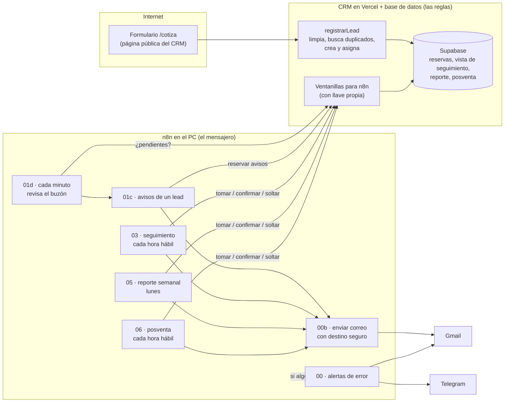

# Guía de la fase 3: automatizaciones en n8n

Qué se construyó, cómo funciona y por qué se tomó cada decisión. Está escrita para explicar el proyecto en una entrevista **sin necesidad de hablar de código**: casi todo aquí es criterio. El detalle técnico de cada flujo está en [plan-fase-3.md](plan-fase-3.md) y en [automatizaciones/README.md](../automatizaciones/README.md).

**Demo:** https://solarandes-crm.vercel.app/cotiza (el formulario público) · **Flujos:** `automatizaciones/flujos/`

---

## 1. La idea en 30 segundos

> Hasta la fase 2, el CRM solo hacía algo cuando una persona entraba y hacía clic. En esta fase el negocio empezó a moverse solo. Cuando alguien pide una cotización en la web, el lead queda guardado, asignado al asesor de su ciudad y avisado en menos de un minuto, sin duplicarse aunque llegue dos veces. Cada mañana, cada asesor recibe la lista de sus ventas que llevan 3 días sin actividad, y la gerente las que llevan 7. Los lunes, la gerente recibe el reporte de la semana, y a los 6 meses de cada instalación el asesor tiene una tarea para agendar el mantenimiento. Si algo falla, llega una alerta por Telegram y por correo. Ningún mensaje le llega a un cliente real: todo pasa por un "destino seguro".

**La analogía de toda la fase:** n8n es el **recepcionista** de la empresa y el CRM es el **archivo**. El recepcionista recibe lo que llega (un formulario, la hora del día), decide a quién avisar y manda los mensajes. Pero no archiva carpetas por su cuenta: se las entrega al archivista, que sabe dónde va cada cosa y si ya existe.

---

## 2. El mapa

**Cómo se lee:** las flechas a la izquierda son el lead entrando; las del centro, n8n preguntándole al CRM; las de la derecha, los correos saliendo. La línea punteada es la red de seguridad: cualquier flujo que falla dispara el 00.

---

## 3. Las piezas

| Flujo | Cuándo corre | Qué hace |
|---|---|---|
| **00 Alertas de error** | Cuando otro flujo falla | Avisa por Telegram **y** por correo (dos canales independientes): qué falló, dónde, cuándo y el enlace a la ejecución |
| **00b Enviar correo seguro** | Lo llaman los demás | Revisa cada destino contra la lista blanca (`destinos_prueba`): lo que no está se desvía al correo de prueba. Dice por cada correo si Gmail lo aceptó |
| **01 Captura web** (webhook) | Cuando llega un lead por webhook | La puerta para futuros canales (WhatsApp); con el CRM caído, guarda el lead en una cola |
| **01b Cola de reintentos** | Cada 2 minutos | Reentrega los leads que quedaron en la cola |
| **01c Avisos de un lead** | Lo llaman 01, 01b y 01d | Pide la **reserva** de avisos y, si es suya, avisa al asesor, da la bienvenida y avisa a la gerente si hay algo que decidir |
| **01d Revisar el buzón** | Cada minuto | Pregunta al CRM qué leads del formulario no tienen avisos y llama a 01c por cada uno |
| **03 Seguimiento de ventas** | Cada hora de 8 a 6, de lunes a viernes | Un resumen al día por persona: al asesor, sus ventas con 3+ días sin actividad; a la gerente, las de 7+ |
| **05 Reporte semanal** | Cada hora de 7 a 6, de lunes a viernes | El reporte de la semana pasada a la gerente, una sola vez por semana |
| **06 Posventa** | Cada hora de 9 a 6, de lunes a viernes | En cada aniversario de 6 meses de un cliente: tarea al asesor para agendar el mantenimiento y recordatorio al cliente |

---

## 4. Las decisiones grandes (y por qué)

**1. n8n orquesta; el CRM guarda las reglas.** n8n nunca escribe directo en las tablas ni tiene su propia copia de "¿es la misma persona?". Le pide al CRM, por una ventanilla, que registre el lead. Las reglas de duplicados ya existían dos veces (Python y TypeScript, fase 2): una tercera copia dentro de n8n terminaría distinta sin que nadie lo notara.

**2. Cada ventanilla tiene una llave propia** (`AUTOMATIZACIONES_TOKEN`), distinta de la llave de la base de datos. Es la diferencia entre darle al mensajero la llave del buzón o la del edificio: si se filtra, se cambia sin tocar nada más.

**3. Lo que no se puede duplicar lo decide la base de datos.** Cada envío del formulario tiene un número único (como un radicado). La base de datos rechaza la segunda vez el mismo número, aunque las dos copias lleguen al mismo milisegundo. Lo mismo con los avisos, los resúmenes y el reporte: se **reservan** en un solo paso, y solo la primera ejecución que pide la reserva la obtiene.

**4. "Destino seguro": ningún mensaje sale hacia el set de datos.** Todo correo pasa por el mismo subflujo (00b), que revisa una lista blanca. Lo demás se desvía al correo de prueba con el asunto "[Prueba: era para …]". La regla "nunca le escribimos a un cliente del set de datos" se cumple **por diseño, no por cuidado**.

**5. El formulario vive en el CRM, no en n8n (el "buzón").** El formulario registra el lead al instante y n8n lo recoge cada minuto. Así el lead nunca se pierde: si el PC con n8n está apagado, el lead igual queda en el CRM, asignado y con su tarea; los avisos salen cuando n8n vuelve. La alternativa (un túnel que exponga n8n a internet) abría la pantalla de n8n al mundo y perdía el lead con el PC apagado.

**6. Una sola regla para "sin seguimiento".** Antes había tres copias (el panel en SQL, el tablero en TypeScript y la del correo). Ahora hay una vista en la base de datos (`seguimiento_ventas`) que usan los tres: el correo, el panel y el tablero nunca dan números distintos.

**7. Duda de duplicado = se crea y se avisa.** En la fase 2, lo dudoso se quedaba afuera (era un Excel viejo, podía esperar). Un lead del formulario es una persona esperando respuesta hoy: perderlo es peor que tener un duplicado, y unir a dos personas distintas sigue siendo lo peor de todo. Se crea y la gerente recibe "posible duplicado de C0123, revísalo".

**8. Alarmas sin ruido.** Una alarma que suena cada minuto se ignora. Por eso "CRM caído" suena la primera vez y luego cada 30 minutos; los flujos con reloj reintentan cada hora y solo avisan una vez al día desde las 12 m.; y las alertas van por dos canales para que una falla de Telegram no deje a nadie a ciegas.

---

## 5. Qué pasa cuando algo falla

| Si… | Pasa… |
|---|---|
| El mismo lead llega dos veces | La base de datos reconoce el número del envío: "ya procesado", sin duplicar nada ni repetir avisos |
| El CRM está caído | El formulario dice "intenta más tarde"; n8n no puede preguntar y llega la alarma (una vez, y luego cada 30 minutos) |
| n8n está apagado (PC apagado) | Los leads quedan en el CRM con su tarea; los avisos salen al volver. Los resúmenes y el reporte salen en la primera hora con el PC prendido |
| Gmail falla | Los avisos de un lead disparan la alerta (se reenvían a mano); el seguimiento, el reporte y la posventa sueltan su reserva y lo intentan la hora siguiente |
| Telegram falla | La alerta igual llega por correo, y queda en rojo diciendo "Telegram falló" |
| Dos ejecuciones toman el mismo trabajo | La reserva en la base de datos deja pasar solo a una |
| n8n se detiene entre enviar y confirmar | A los 30 minutos la reserva se da por abandonada y se reintenta: puede llegar repetido. Aceptado: un resumen repetido molesta poco; uno perdido es un lead olvidado |
| No hay gerente activa | Lo que le toca a ella no tiene a quién llegar: suena la alarma en vez de perderse en silencio |

---

## 6. Lo que salió mal y se aprendió

Cada error real mejoró el diseño. Son buenas historias para una entrevista ("cuéntame de un error que cometiste"):

- **Los avisos salieron dos veces.** Se usó una tabla de n8n con "¿ya se avisó?" y se anotaba al terminar. El mismo envío llegó mientras los correos todavía salían, y la revisión no encontró nada. Es el problema clásico de **"revisar y después actuar"**: entre las dos cosas queda una ventana. Se resolvió con una reserva en la base de datos, en un solo paso. Desde ahí, todo lo que no se puede duplicar se diseñó así.
- **El flujo de errores no avisaba.** En n8n 2.x tiene que estar publicado; si no, la falla pasa en silencio. Por eso se probó a propósito con un flujo que falla (el 99).
- **n8n reescribe los mensajes de error** con códigos de red (`ECONNREFUSED`) por un texto genérico en inglés. Los motivos se traducen a español antes de usarlos en la alarma.
- **Telegram rechazó una alerta** porque leyó `leads_pendientes` como formato (Markdown). Se descubrió porque la alerta llegó solo por correo: para eso son dos canales.
- **Un correo podía darse por enviado sin haber salido.** Si a n8n le faltaba la credencial de Gmail, el paso de correo dejaba pasar los mensajes "sin error". Ahora "salió" se comprueba en positivo: solo si Gmail lo aceptó.
- **Un error de la fase 1 apareció en la fase 3.** Una venta que pasaba directo de perdida a ganada conservaba su fecha de cierre vieja: el reporte no la contaba y la posventa la habría recordado en otra fecha. Se corrigió en la base de datos.
- **El método que quedó:** antes de construir cada flujo, una tabla de "qué puede fallar" revisada por otro par de ojos. Las revisiones del diseño encontraron entre 10 y 14 puntos cada una **antes** de escribir código, que es cuando corregir es barato.

---

## 7. Calidad: pruebas y revisiones

- **Base de datos:** pruebas con pytest contra la base real, dentro de transacciones que se deshacen al final. Incluyen envíos simultáneos desde varias conexiones (de 10 envíos a la vez desde la misma conexión, pasan exactamente 5), aniversarios del 31 de agosto, ventas que cambian de asesor y semanas que cruzan la medianoche en UTC.
- **CRM:** pruebas con Vitest de la lógica (limpiar un lead, escribir los correos, el formulario), simulando la base de datos.
- **Flujos:** pruebas que revisan que ningún flujo traiga correos, celulares ni secretos escritos a mano (el repo es público) y que todos tengan su flujo de errores.
- **En vivo:** cada flujo se probó contra el CRM real (local y publicado), con el CRM apagado a propósito, y con el mismo lead enviado dos veces.
- **Revisiones:** cada diseño y cada entrega pasaron por un revisor antes del commit.

---

## 8. Límites y qué haría en producción

- **n8n corre en el PC de Gabriel.** Si está apagado, los avisos esperan (los leads no se pierden). En producción iría en un servidor (n8n recomienda Docker) o en n8n Cloud, y el flujo de errores avisaría a las 3 a. m.
- **WhatsApp (flujo 2) y Google Calendar (flujo 4) quedaron para después:** son los más engorrosos de configurar (Meta, Google Cloud) y no eran parte del "Listo cuando".
- **Un recordatorio real a clientes** debería traer una forma de darse de baja, y la autorización de datos debería cubrir el contacto posventa.
- **El CRM no guarda la fecha de instalación:** la posventa usa la fecha en que se ganó la venta. Agregar esa fecha solo cambia una función.
- **Un robot que pase los filtros del formulario** deja leads basura (topados en 60 por hora y 100 por día). El siguiente paso sería un captcha como Cloudflare Turnstile.

---

## 9. Glosario

| Término | Qué es |
|---|---|
| **Flujo (workflow)** | Una automatización de n8n: un disparador (un formulario, la hora) y una serie de pasos |
| **Webhook** | Una dirección a la que otro sistema le manda datos cuando pasa algo |
| **Idempotencia** | Que hacer algo dos veces dé el mismo resultado que hacerlo una (el mismo lead dos veces = un lead) |
| **Reserva** | Marcar en la base de datos "esto lo hago yo", en un solo paso, para que nadie más lo haga |
| **Revisar y después actuar** | El error de preguntar "¿ya se hizo?" y luego hacerlo: entre las dos cosas, otro puede colarse |
| **Subflujo** | Un flujo que otros llaman, como una función: 01c (avisos) y 00b (correo seguro) |
| **Lista blanca** | Los únicos destinos permitidos; todo lo demás se bloquea o se desvía |
| **Flujo de errores** | El flujo que n8n corre cuando otro falla (el 00) |
| **Vista** | Una consulta guardada con nombre en la base de datos; aquí, la regla única de seguimiento |
| **Cron** | La forma de decir "a qué horas corre": `0 8-18 * * 1-5` = en punto, de 8 a 18, de lunes a viernes |
| **Llave (token)** | Un secreto que prueba quién llama; cada ventanilla del CRM exige la de las automatizaciones |

---

## 10. Preguntas probables de entrevista

**¿Qué pasa si el mismo lead llega dos veces?**
Cada envío trae un número único, y la base de datos guarda los números que ya recibió con una regla que impide repetirlos. La segunda vez responde "ya procesado": no se crea otro contacto ni salen avisos otra vez. Lo hace la base de datos y no n8n porque es la única que puede garantizarlo cuando las dos copias llegan al mismo tiempo.

**¿Y si WhatsApp está caído?** (WhatsApp quedó para después, pero el diseño ya lo responde)
WhatsApp sería otra puerta al mismo proceso. Si la puerta del CRM no responde, el mensaje se guarda en la cola de reintentos (01b), que lo reentrega cada 2 minutos y avisa si sigue fallando. Si lo que se cae es el envío de WhatsApp, el flujo falla y llega la alerta, igual que hoy con Gmail.

**¿Cómo sabrías que un flujo falló a las 3 a. m.?**
Todos los flujos tienen un flujo de errores que avisa por Telegram y por correo, con el paso que falló y el enlace a la ejecución. Son dos canales independientes, así que si uno falla el otro llega. Honestamente: hoy n8n corre en un PC, así que a las 3 a. m. probablemente está apagado; en producción iría en un servidor.

**¿Por qué n8n no escribe directo en la base de datos?**
Porque las reglas (duplicados, asignación) ya existían en el CRM y una tercera copia en n8n terminaría distinta. n8n es el mensajero; el CRM es el que sabe.

**¿Cómo evitas mandarle un correo de prueba a un cliente real?**
Todo correo pasa por un mismo paso (destino seguro) con una lista blanca. Lo que no está en la lista se desvía al correo de prueba. Además, una prueba automática revisa que ningún flujo tenga correos ni celulares escritos a mano.

**¿Cómo decides cuándo suena una alarma?**
Pensando en quién la recibe: una alarma que suena cada minuto se ignora. La primera vez suena, y luego se espacia (cada 30 minutos para el CRM caído, una vez al día para lo que se reintenta solo).

**¿Qué harías distinto?**
Empezar cada flujo con la tabla de "qué puede fallar" desde el primer día (en el flujo 1 se aprendió a golpes) y poner n8n en un servidor desde el principio.
