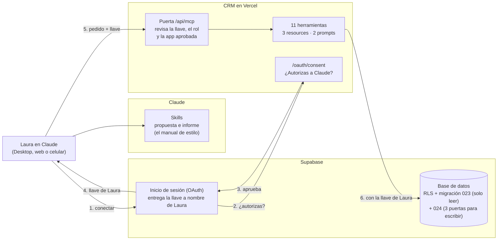

# Guía de la fase 5: servidor MCP y skills

Qué se construyó, cómo funciona y por qué se tomó cada decisión. Está escrita para explicar el proyecto en una entrevista **desde el criterio, sin necesidad de hablar de código**. El detalle técnico, las tablas de "qué puede fallar" y las revisiones están en [plan-fase-5.md](plan-fase-5.md); cómo conectarlo, en [mcp-instalacion.md](mcp-instalacion.md).

**Servidor MCP:** `https://solarandes-crm.vercel.app/api/mcp` · **Skills:** `skills/`

---

## 1. La idea en 30 segundos

> Hasta la fase 4, para saber algo del negocio, Laura (la gerente) tenía que abrir el CRM y buscar la pantalla correcta. Ahora le pregunta a Claude: *"¿qué asesor tiene más leads sin seguimiento?"*, *"agéndale una visita a Pedro el jueves"*, *"hazme la propuesta de la panadería"*. Claude responde con los **mismos números del panel**, y actúa en el CRM **a nombre de ella y con sus permisos**, nunca con una llave maestra. Lo que no está en el menú (borrar, marcar una venta como ganada), Claude no lo puede hacer, ni siquiera si un mensaje de un cliente se lo pide.

**La analogía de toda la fase:** el servidor MCP es una **ventanilla de atención con un menú fijo**. Claude es un **mensajero que lleva el carné de Laura**: puede pedir en la ventanilla lo que está en el menú, y el archivo (la base de datos) le entrega solo lo que el carné de Laura permite. Las **skills** son el **manual de estilo** de la empresa: cómo se ve una propuesta de SolarAndes, cómo se cuenta el informe del mes.

---

## 2. El mapa

---

## 3. Las piezas, en una línea cada una

| Pieza | Qué es | Dónde |
|---|---|---|
| **1. La puerta con llave** | Laura entra con su usuario del CRM (OAuth de Supabase) y Claude recibe una llave **a nombre de ella**. La puerta revisa la llave, que sea la gerente y que la app esté aprobada. La migración 023 hace que cualquier llave de app conectada **solo pueda leer** | `src/lib/mcp/llave.ts`, `src/app/api/mcp/`, `src/app/oauth/consent/`, migración 023 |
| **2. Las consultas** | 6 herramientas de solo lectura (ficha, ventas, sin seguimiento, panel, agenda, precio) y 3 resources (catálogo, precios, ficha completa). **Las mismas cifras del panel**, leídas de las mismas vistas y funciones de la base | `src/lib/mcp/consultas.ts`, `datos.ts` |
| **3. Las acciones** | Registrar actividad, mover venta y agendar visita: **tres puertas exactas** en la base (migración 024), que **también usa el CRM**. Sin "ganado" ni reabrir desde Claude, tope de 50 al día y registro de todo, también de lo rechazado | migración 024, `src/lib/mcp/acciones.ts` |
| **4. Los prompts** | "Resumen del día" y "Leads en riesgo": recetas que Laura elige del menú | `src/lib/mcp/prompts.ts` |
| **5. Publicado** | En Vercel, con la dirección principal de Supabase apuntando al CRM publicado | — |
| **6 y 7. Las skills** | Propuesta comercial en PDF con la marca, e informe gerencial con gráficos. **La IA redacta, el CRM pone los números** | `skills/` |

---

## 4. Las decisiones que más pesan (y por qué)

1. **Remoto, dentro del CRM, y no un programa en el PC de Laura.** Laura no es técnica: pegar una dirección y entrar con su usuario es lo que haría una empresa real. Además funciona en el celular y no depende de que un PC esté prendido (a diferencia de n8n).
2. **Con el carné de Laura, nunca con la llave maestra.** Si el MCP usara la llave de servicio, se saltaría todos los permisos, y el historial diría "lo hizo el sistema". Con la llave de Laura, la base aplica sus permisos (RLS) y el historial dice "lo hizo Laura".
3. **El candado vive en la base, no en el MCP.** La llave que recibe Claude también sirve para hablarle a Supabase **directamente**, saltándose el MCP. Por eso "el MCP no tiene botón de borrar" no basta: la migración 023 hace que una llave de app conectada no pueda escribir en ninguna tabla, y las únicas escrituras pasan por las tres funciones de la 024. Es la lección de la fase 3: **por diseño, no con cuidado**.
4. **Una sola regla para el CRM y para Claude.** Las reglas de registrar, mover y agendar vivían en el CRM, en TypeScript. Se pasaron a la base y el CRM las usa también: si no, habría dos copias que algún día dirían cosas distintas.
5. **Claude no marca ventas como ganadas.** Ganar dispara la posventa de n8n: tareas y recordatorios reales. Si un mensaje con instrucciones lograra que Claude lo hiciera, el daño saldría del CRM. Se hace en el tablero, donde es un acto deliberado.
6. **Los números del panel, no otros.** Ninguna regla se reescribió para el MCP: el seguimiento sale de la misma vista del panel y el correo de n8n, y los porcentajes, de la misma función del panel. Se comprobó en vivo: coincidieron exactamente.
7. **Lo que escribió un desconocido es dato.** Los mensajes de los leads llegan marcados como datos; las listas no traen teléfonos ni correos, y los que el cliente escribió dentro de un mensaje se tapan; las acciones piden confirmación; y todo queda registrado.

---

## 5. Las preguntas de "Explícalo tú"

**¿Cuál es la diferencia entre un tool, un resource y un prompt? ¿Por qué cada cosa quedó donde quedó?**
La diferencia es **quién decide usarlo**:
- Un **tool** lo decide **Claude**: es un botón que puede apretar, como buscar un cliente o agendar una visita.
- Un **resource** lo adjunta **la persona**: es un documento de consulta, como el catálogo o la tabla de precios.
- Un **prompt** lo elige **la persona** del menú: es una receta guardada, como el "Resumen del día".

La ficha del cliente está en los dos lados. Como herramienta no trae teléfono ni correo, porque Claude podría pedir las mil fichas seguidas. Como resource sí los trae, porque Laura la adjunta a mano y de a una.

**¿Qué impide que alguien borre clientes por medio del MCP?**
Cuatro capas, de afuera hacia adentro:
1. No hay herramienta de borrar.
2. Claude pide confirmación antes de cada acción (es una ayuda, no un candado).
3. Los permisos de la base (RLS) aplican con la llave de Laura.
4. La migración 023: una llave de app conectada **no puede insertar, cambiar ni borrar**, aunque alguien la use directo contra la base, sin el MCP. Se probó con una llave real: Supabase rechazó la escritura nombrando la regla.

La capa 4 es la que funciona aunque todo lo demás falle.

**¿Cuándo conviene una skill y cuándo un servidor MCP?**
- **MCP** cuando Claude necesita **datos vivos o actuar** en un sistema: el CRM cambia cada minuto, y los permisos dependen de quién pregunta.
- **Skill** cuando necesita **saber hacer algo** de una manera particular: el formato de la propuesta, la marca, cómo contar el informe. Una skill no da acceso a nada.
- **Juntos:** la skill dice *cómo*, el MCP da *los datos*.

---

## 6. Las cifras para la entrevista

- **11 herramientas** (8 de lectura y 3 que escriben), **3 resources** y **2 prompts**. Ninguna herramienta borra.
- **Pruebas:**
  - 257 en el CRM (Vitest);
  - 29 de las acciones y 10 de "las apps solo leen", contra la base real;
  - 23 de las skills.
- **Cuatro revisiones de diseño y cuatro de código** con un revisor aparte. La más importante encontró que la llave sirve para hablarle directo a la base, y de ahí salió la migración 023.
- **Probado en vivo con OAuth real:** las cifras de Claude coincidieron exactamente con el panel (9 ganadas, −62 %, cierre del 16 %, 104 sin seguimiento). "Marcar ganado" fue rechazado y quedó en el registro.
- **Costo:** USD 0 adicionales. El MCP vive en Vercel y Supabase gratis; lo que "piensa" Claude sale de la suscripción de la gerente, no del crédito de la API.

---

## 7. Límites dichos con honestidad

- **Con la llave se puede leer** directo de la base todo lo que ve Laura. El candado frena escribir, no leer. La llave vence en una hora y solo la reciben apps aprobadas.
- **Una inyección podría intentar "silenciar" ventas olvidadas** registrando actividades, o marcar ventas como perdidas. Lo acotan el tope de 50, la confirmación y el registro, pero no lo impiden.
- **Otros conectores en la misma conversación** (correo, web) no los controla el CRM. Por eso la recomendación es usar el CRM en conversaciones sin ellos.
- **Un enlace de autorización ajeno:** si alguien le manda a Laura uno legítimo de Claude, la página diría "claude.ai". La defensa es el aviso de la página.
- **La verificación final con Claude Desktop la hace Gabriel con su cuenta.** Todo lo demás se probó con un cliente MCP propio que hace lo mismo que Claude.
