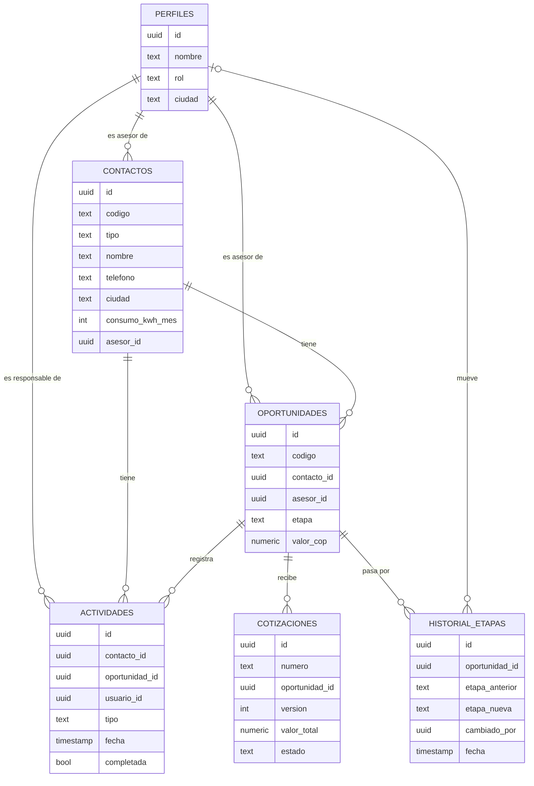

# Modelo de datos del CRM

Cómo se organiza la información de SolarAndes en la base de datos (Supabase, que por dentro es Postgres).

**En una frase:** un **contacto** tiene **oportunidades** de venta; cada oportunidad acumula **actividades**, **cotizaciones** y un **historial** de las etapas por las que pasó; y todo tiene un **responsable** del equipo.

---

## 1. Diagrama

Cómo leer las líneas: `||--o{` significa "uno a muchos". Por ejemplo, **un** contacto tiene **muchas** (o ninguna) oportunidades.

`productos` (el catálogo) es una tabla independiente y por eso no aparece conectada.

---

## 2. Las tablas, una por una

### `perfiles`: las personas del equipo
Quiénes usan el sistema y qué rol tienen. El correo y la contraseña los maneja Supabase en su propio sistema de usuarios; esta tabla agrega lo que es de SolarAndes.

| Campo | Qué guarda | Ejemplo |
|---|---|---|
| `id` | Identificador, el mismo del usuario de Supabase | (automático) |
| `nombre` | Nombre completo | Andrés Rojas |
| `email` | Correo | andres.rojas@solarandes.test |
| `rol` | `gerente`, `asesor`, `tecnico` o `contadora` | asesor |
| `ciudad` | Ciudad que atiende (los asesores) | Bogotá |
| `activo` | Si todavía trabaja en la empresa | sí |

### `contactos`: los clientes y posibles clientes
| Campo | Qué guarda | Ejemplo |
|---|---|---|
| `id` | Identificador interno | (automático) |
| `codigo` | Código legible para humanos | C0001 |
| `tipo` | `hogar` o `negocio` | hogar |
| `nombre` | Persona de contacto | Paola Torres |
| `empresa` | Solo si es negocio | Panadería Gómez |
| `telefono` | Formato `+57XXXXXXXXXX` | +573204989513 |
| `email` | Correo | paola.torres@example.net |
| `ciudad` | Bogotá, Medellín o Cali | Bogotá |
| `direccion` | Dirección | Cl. 110 # 26-5 |
| `estrato` | Solo hogares, 1 a 6 | 4 |
| `consumo_kwh_mes` | Consumo de su factura de luz | 300 |
| `canal_origen` | `anuncios`, `whatsapp`, `web` o `referido` | anuncios |
| `asesor_id` | Asesor responsable → `perfiles` | Andrés |
| `creado_en` / `actualizado_en` | Fechas automáticas | |

### `oportunidades`: cada posible venta
| Campo | Qué guarda | Ejemplo |
|---|---|---|
| `codigo` | Código legible | O0001 |
| `contacto_id` | De quién es → `contactos` | Paola Torres |
| `asesor_id` | Quién la lleva → `perfiles` | Andrés |
| `tipo` | `nueva` o `ampliacion` | nueva |
| `nombre` | Título corto | Sistema 3.3 kWp - Paola Torres |
| `etapa` | En qué paso del embudo va | cotizado |
| `potencia_kwp` | Tamaño del sistema | 3.3 |
| `valor_cop` | Valor de la venta | 14.850.000 |
| `probabilidad` | % de cierre según la etapa | 50 |
| `motivo_perdida` | Solo si se perdió | precio |
| `creada_en` / `actualizada_en` / `fecha_cierre` | Fechas | |

### `actividades`: todo lo que pasa con un cliente
Llamadas, mensajes, correos, visitas técnicas, notas y tareas pendientes.

| Campo | Qué guarda | Ejemplo |
|---|---|---|
| `contacto_id` | Con quién → `contactos` | Paola Torres |
| `oportunidad_id` | Sobre qué venta (opcional) → `oportunidades` | O0001 |
| `usuario_id` | Quién la hace o la tiene asignada → `perfiles` | Jhon Fredy (técnico) |
| `tipo` | `llamada`, `whatsapp`, `correo`, `visita`, `nota` o `tarea` | visita |
| `descripcion` | Qué pasó o qué hay que hacer | Revisar techo y tablero |
| `fecha` | Cuándo pasó o cuándo hay que hacerla | 24/10/2026 9:00 |
| `completada` | Si ya se hizo | no |

### `cotizaciones`: las propuestas de precio enviadas
| Campo | Qué guarda | Ejemplo |
|---|---|---|
| `numero` | Consecutivo oficial | COT-2026-0145 |
| `oportunidad_id` | De qué venta → `oportunidades` | O0001 |
| `version` | 1 la original, 2 si se ajustó | 1 |
| `consumo_kwh_mes`, `potencia_kwp`, `num_paneles`, `precio_kwp` | Los datos del cálculo | 300 · 3.3 · 6 · 4.500.000 |
| `descuento_pct` | Descuento aplicado | 5 |
| `valor_total` | Precio final | 14.108.000 |
| `estado` | `enviada`, `aceptada`, `rechazada` o `reemplazada` | enviada |

### `historial_etapas`: el recorrido de cada venta (tabla nueva)
Cada vez que una oportunidad cambia de etapa, queda un registro.

| Campo | Qué guarda | Ejemplo |
|---|---|---|
| `oportunidad_id` | Qué venta → `oportunidades` | O0001 |
| `etapa_anterior` / `etapa_nueva` | De dónde a dónde | contactado → visita_agendada |
| `cambiado_por` | Quién la movió → `perfiles`. **Vacío = lo hizo el sistema** (pasa en el primer paso, cuando llega el lead) | Andrés |
| `fecha` | Cuándo | 12/03/2026 |

### `productos`: el catálogo
SKU, nombre, categoría, precio y si está activo. Ya existe en los datos generados.

---

## 3. Decisiones de diseño (y por qué)

**D1. Hogares y negocios en una sola tabla de contactos.**
Comparten casi todos los campos; solo cambian `empresa` y `estrato`, que quedan vacíos cuando no aplican. Dos tablas duplicarían pantallas, búsquedas y automatizaciones.

**D2. Guardar el historial de etapas.**
Sin él, solo se sabe en qué etapa está una venta *hoy*. Con él se pueden responder las preguntas de Laura: *¿en qué etapa se pierden más ventas? ¿cuánto tarda en promedio una venta en cerrarse?* Los datos generados ya lo incluyen (`data/generados/historial_etapas.csv`).

**D3. Las cotizaciones guardan una "foto" del cálculo.**
Si los precios suben el próximo año, una cotización vieja debe seguir mostrando el precio que se le dio al cliente ese día. Por eso se guardan los números, en vez de recalcularlos cada vez.

**D4. Identificador interno más código legible.**
Cada registro tiene un `id` interno (UUID, un código largo y único que genera la base de datos) y un `codigo` corto para personas (C0001, O0001). Así un asesor puede decir "el cliente C0153" sin exponer los identificadores internos.

**D5. Las etapas son una lista fija.**
Las 7 etapas de `docs/requisitos.md` quedan definidas en la base de datos, y no se puede guardar una etapa que no exista. Si algún día SolarAndes quiere cambiar su embudo, se convierte en una tabla configurable. Hoy sería complicar algo que no se necesita.

---

## 4. Quién ve qué (permisos)

Supabase lo controla **dentro de la base de datos** con *Row Level Security* (seguridad por fila): aunque alguien manipule la app, la base de datos solo le entrega las filas que le corresponden.

| Tabla | Gerente | Asesor | Técnico | Contadora |
|---|---|---|---|---|
| `perfiles` | Ve y edita todos | Ve todos (nombres) | Ve todos (nombres) | Ve todos (nombres) |
| `contactos` | Todo | Solo los suyos | Nada directo: usa la vista `visitas_tecnico` | Nada (fase 4) |
| `oportunidades` | Todo | Solo las suyas | Nada | Nada |
| `actividades` | Todo | Las de sus contactos | Solo las asignadas a él | Nada |
| `cotizaciones` | Todo | Las de sus oportunidades | Nada | Nada |
| `historial_etapas` | Todo | El de sus oportunidades | Nada | Nada |
| `productos` | Ve y edita | Solo ve | Solo ve | Solo ve |

**El técnico no ve valores de venta:** solo necesita saber a quién visita, dónde y qué revisar.

### Filas vs. columnas
Row Level Security decide **qué filas** ve cada persona, pero no **qué columnas**. Si el técnico pudiera leer la tabla `contactos`, vería todo el registro de sus clientes: correo, consumo, estrato, asesor.

Por eso el técnico no lee `contactos` directamente. Lee una **vista** llamada `visitas_tecnico`: una consulta guardada que solo trae, de sus visitas asignadas, la fecha, la descripción, y el nombre, teléfono y dirección del cliente. Es como entregarle una fotocopia de la ficha con los datos sensibles tapados.
