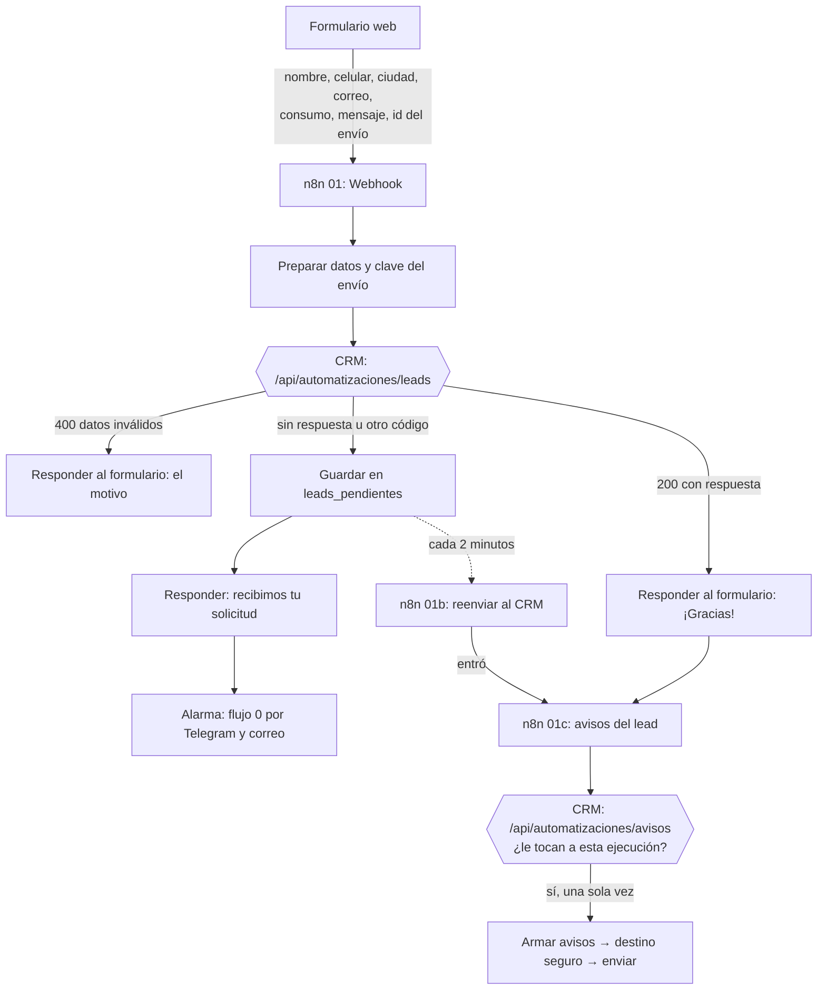

# Plan de la fase 3: automatizaciones en n8n

*Escrito al empezar la fase (2026-10-23). Se actualiza cuando cambie una decisión.*

---

## 1. La idea en 30 segundos

Hasta ahora el CRM solo hace algo cuando una persona entra y hace clic. En esta fase el negocio empieza a **moverse solo**: cuando llega un lead, queda guardado, asignado y avisado sin que nadie lo toque; cuando un lead se enfría, alguien se entera; el lunes, Laura recibe sus números.

Lo hace **n8n**, que funciona como el **recepcionista** de la empresa: recibe lo que llega (un formulario, un WhatsApp, la hora del día), decide a quién avisar y manda los mensajes. El **CRM es el archivo**, con sus reglas. El recepcionista no archiva carpetas por su cuenta: se las entrega al archivista, que sabe dónde va cada cosa y si ya existe.

Resuelve dos problemas de [requisitos.md](requisitos.md): **P4** (los leads tardan horas en ser atendidos y se olvidan los seguimientos) y **P5** (el técnico se entera tarde de sus visitas).

---

## 2. Los flujos, en orden

| # | Flujo | Cuándo se dispara | Qué hace | Necesita |
|---|---|---|---|---|
| 0 | **Alertas de error** ✅ | Cuando cualquier otro flujo falla | Avisa por Telegram (y correo) qué falló, cuándo y con enlace a la ejecución. Hecho y probado el 2026-10-23, con Telegram y correo como canales independientes | Telegram + correo (SMTP) |
| 1 | **Captura de leads por la web** | Alguien llena el formulario | Revisa duplicados, crea el lead en el CRM, lo asigna, da la bienvenida y avisa al asesor | CRM + correo |
| 2 | **Captura por WhatsApp** ⏸️ pospuesto | Alguien le escribe al número de la empresa | Lo mismo que el 1, pero desde WhatsApp | Meta (WhatsApp) + n8n visible desde internet |
| 3 | **Seguimiento** | Todos los días a las 8 a. m. | Lead con 3 días sin actividad → recordatorio al asesor; con 7 → aviso a Laura | CRM + correo |
| 4 | **Visitas técnicas** ⏸️ pospuesto | Un asesor agenda una visita en el CRM | Crea el evento en el calendario, avisa al técnico y le recuerda al cliente el día antes | Google Calendar |
| 5 | **Reporte semanal** | Cada lunes a las 7 a. m. | Correo a Laura con las métricas de la semana | CRM + correo |
| 6 | **Posventa** | Todos los días | Instalación cumple 6 meses → recordatorio de mantenimiento | CRM + correo o WhatsApp |
| 7 | **Entrega** | Al final | Flujos exportados al repo, documentación, diagrama y guía de estudio | — |

**Decisión de Gabriel (2026-10-24): WhatsApp (2) y visitas técnicas con Google Calendar (4) quedan para después.** Son los más engorrosos de configurar (Meta for Developers con su llave que vence y su verificación de números; Google Cloud con su permiso que vence cada 7 días en modo prueba) y no son parte del "Listo cuando". La fase sigue con: terminar la captura web (publicar, formulario y túnel), seguimiento (3), reporte semanal (5), posventa (6) y la entrega (7).

**Por qué este orden:**
- **El 0 va primero** porque todos los demás se cuelgan de él. Construirlo al final sería como instalar la alarma de incendios después de mudarse.
- **El 1 es el corazón** de la fase y el que pide el "Listo cuando". Empieza por la web y no por WhatsApp porque la web no depende de Meta: así probamos toda la cadena antes de pelear con la configuración de WhatsApp.
- **El 2 reutiliza el 1**: WhatsApp solo es otra puerta de entrada al mismo proceso.
- **Del 3 al 6** son flujos "con reloj" (se disparan por horario) y se parecen entre sí; el 3 es el más útil para el negocio.

---

## 3. Qué decides tú y qué decido yo

### Lo tuyo (cuentas, dinero y publicar)

**A. Dónde corre n8n.** Es la decisión más importante, porque WhatsApp y el formulario público necesitan que n8n sea **visible desde internet** (que tenga una dirección a la que otros puedan mandarle cosas).

| Opción | Costo | A favor | En contra |
|---|---|---|---|
| **Local en tu PC (D:) + un túnel** | Gratis | Todo en tu máquina; es lo que dice el PLAN | Solo funciona con el PC prendido. El túnel (por ejemplo Cloudflare Tunnel) es un "pasillo" que hace visible tu n8n en internet mientras está abierto |
| **n8n Cloud** | Prueba gratis de 14 días, luego pago mensual | Siempre prendido, cero instalación | Cuesta; la prueba se acaba en medio de la fase |
| **Un servidor propio (VPS)** | Unos USD 5 al mes | Siempre prendido; se ve muy profesional | Hay que administrar un servidor |

**Decidido (2026-10-23): local + túnel.** n8n 2.44.6 instalado en `D:\herramientas\n8n`; sus datos (flujos, credenciales cifradas y la llave que las cifra) en `D:\herramientas\n8n\datos`. Se prende con la configuración `n8n` de `.claude/launch.json`, en http://localhost:5678. El túnel se instala cuando haga falta que internet llegue a n8n (formulario público y WhatsApp). La versión queda **fija** para que una actualización no cambie nada sin aviso. n8n avisa que en versiones futuras exigirá correr dentro de Docker (un "contenedor": una caja que trae el programa con todo lo que necesita); si algún día se pasa a un servidor, se hace así. Los nodos de código se escriben en JavaScript (el ejecutor de Python no está instalado y no hace falta).

**Por qué esta opción:** **local + túnel** para construir (gratis, y es lo previsto). Para la presentación de la fase 7 decides si vale la pena pagar un servidor unos meses. Honestidad para la entrevista: "¿cómo sabrías que un flujo falló a las 3 a. m.?" tiene una respuesta distinta si n8n está apagado; en producción iría en un servidor.

**B. Las cuentas** (las creas tú; nunca pegues contraseñas ni llaves en el chat):

| Cuenta | Para qué | Cuándo |
|---|---|---|
| **Telegram + un bot** (se crea en 2 minutos hablándole a @BotFather) | Las alertas de error en tu celular | Flujo 0 |
| **Gmail exclusivo de SolarAndes** (ya estaba en el PLAN) | Bienvenida al lead, avisos al asesor, reporte del lunes y respaldo de las alertas (✅ creado) | Flujo 0 y 1 |
| **Contraseña de aplicación de Gmail** (✅ hecha) | Para que n8n envíe correos por SMTP. Se intentó primero un proyecto de Google Cloud con OAuth, pero Google lo marcó como posible infracción al crearlo (cuenta nueva, permisos de Gmail): para enviar correos no hace falta | Flujo 0 y 1 |
| **Google Calendar** (pendiente de decidir) | Crear los eventos de las visitas. Sin Google Cloud no hay acceso oficial al calendario: se decide al llegar al flujo 4 (apelar en Google Cloud u otra vía) | Flujo 4 |
| **Meta for Developers** con el número de prueba de WhatsApp | Recibir y enviar WhatsApp. El número de prueba solo le escribe a máximo 5 números que tú verifiques: justo lo que queremos | Flujo 2 |

**C. Los destinos de prueba autorizados**: qué celular(es) y correo(s) tuyos pueden recibir mensajes de verdad. Todo lo demás se desvía (ver la decisión 5).

**D. Una variable en Vercel**: el CRM publicado necesitará una llave nueva (la decisión 2). Agregarla en Vercel es tocar tu cuenta, así que lo haces tú o me das el visto bueno.

### Lo mío (decisiones técnicas, ya tomadas)

1. **n8n orquesta; el CRM guarda las reglas.** n8n no escribe directo en las tablas ni lleva su propia copia de "¿es la misma persona?". Le pide al CRM, por una puerta de entrada (`/api/automatizaciones/leads`), que registre el lead. **¿Por qué?** Las reglas de duplicados ya existen dos veces (Python y TypeScript, [guia-fase-2.md](guia-fase-2.md)) y se prueban con los mismos casos. Una tercera copia dentro de n8n terminaría diferente sin que nadie lo note. Con esta decisión, **la captura usa exactamente las reglas de la fase 2**. De paso, la prueba del "Listo cuando" (apagar el CRM y que llegue la alerta) tiene sentido: si el archivista no responde, el recepcionista avisa.

2. **La puerta de entrada tiene una llave propia**, distinta de la llave de servicio de Supabase. n8n solo conoce esa llave, y esa llave solo abre esa puerta. Si se filtra, se cambia sin tocar nada más. Es la diferencia entre darle al mensajero la llave del buzón o la del edificio.

3. **Nada se duplica si el mismo lead llega dos veces.** Cada envío trae una **clave de idempotencia**: un número único del envío (como el número de radicado de un trámite). La base de datos guarda esas claves y **rechaza la segunda vez** la misma clave, aunque las dos lleguen al mismo milisegundo. Lo hace la base de datos y no n8n, porque es la única que puede garantizarlo cuando dos copias llegan juntas. Es lo de la fase 1: **las reglas que no se pueden romper viven en la base de datos.**

4. **La asignación sigue la regla del cliente.** [requisitos.md](requisitos.md) dice: cada lead va al asesor de su ciudad. El PLAN dice "rotativa". Las junto así: el lead va a los asesores **activos** de su ciudad, y si hay varios, al que lleva más tiempo sin recibir uno (eso es la rotación). Si la ciudad no tiene asesor activo (vacaciones, renuncia: el dolor de Laura), se rota entre todos y se le avisa a Laura. Hoy hay un asesor por ciudad, así que se comporta como siempre; la rotación queda lista para cuando crezca el equipo.

5. **"Destino seguro": ningún mensaje real sale hacia el set de datos.** Todo envío pasa por un mismo paso que revisa una **lista blanca** (los destinos de prueba de la decisión C). Si el destino no está, el mensaje **se desvía** a tu correo de prueba con el asunto "[Prueba: era para …]". Los correos del equipo (`@solarandes.test`) no existen, así que los avisos a asesores también llegan ahí. Así se cumple la regla de `CLAUDE.md` por diseño, no por cuidado.

6. **`historial_etapas.cambiado_por` vacío = "lo hizo el sistema".** El pendiente de la fase 1 se resuelve con lo que ya dice [modelo-datos.md](modelo-datos.md) (D2): el primer paso de una venta (`nuevo`) lo hace el sistema cuando llega el lead, y vacío significa exactamente eso. Ningún flujo de esta fase mueve ventas de etapa (eso lo hace el asesor en el CRM), así que no hace falta inventar un "usuario robot". Si un flujo futuro mueve etapas, se crea uno.

7. **Duda de duplicado = se crea igual y se avisa.** En la fase 2, lo dudoso se quedaba afuera, porque era un Excel viejo y podía esperar. Un lead del formulario es una persona **esperando respuesta hoy**. Perderlo es peor que tener un duplicado, y unir a dos personas sigue siendo lo peor de todo. Entonces: se crea como contacto nuevo y Laura recibe "posible duplicado de C0123, revísalo".

8. **Cada flujo, con prueba y en el repo.** La lógica (duplicados, asignación, idempotencia) se prueba con pruebas automáticas en el CRM y en la base de datos. Los flujos se exportan como archivos a `automatizaciones/`; los archivos exportados **no incluyen las credenciales**, que se quedan guardadas (cifradas) dentro de n8n.

---

## 4. El primer flujo, diseñado (y construido): captura de leads por la web

### El recorrido

Todos los correos pasan por el paso **Destino seguro** antes de salir. Los detalles de cada flujo están en `automatizaciones/README.md`.

### Lo que pasa dentro del CRM (la puerta de entrada)

1. Revisa la llave. Sin llave o con una equivocada → "no autorizado" y no hace nada.
2. Limpia los datos con las reglas de la fase 2: celular a `+57…`, ciudad bien escrita, nombre con mayúsculas. Si falta algo obligatorio (celular, ciudad) → "datos inválidos", y **n8n no reintenta**: reintentar no arregla un celular mal escrito.
3. ¿Esta clave de envío ya llegó? → "ya procesado", con el mismo código de contacto de la primera vez.
4. Busca a la persona en el CRM con `buscarEnCrm`, la misma función de la importación de CSV.
5. Según el resultado: crea el contacto con su oportunidad y le asigna asesor; o, si ya existe, le anota una actividad "Volvió a escribir por la web: …".
6. En los dos casos le deja al asesor una **tarea**: "Contactar a este lead". Esa tarea es la que el flujo 3 vigilará para el seguimiento.
7. Responde a n8n: qué pasó, el código del contacto (C0281) y a quién se asignó.

Los pasos 3 a 6 ocurren **en una sola operación** de la base de datos: o se guarda todo, o nada (como `crear_contacto_con_venta` en la fase 1).

**Lo que quedó construido en la base de datos (migraciones 009 y 010, aplicadas el 2026-10-24):**
- `envios_recibidos`: el libro de radicados (clave única por envío).
- `asesor_para_lead(ciudad)`: asesor activo de la ciudad; entre varios, el que lleva más tiempo sin recibir un contacto; sin asesor en la ciudad, rota entre todos (y la respuesta trae `fuera_de_ciudad`).
- `capturar_lead(...)`: solo la llama la llave de servicio. Casos: lead nuevo (`creado`), cliente que vuelve (`existente`), dudoso (`revision`: si su celular ya es de otro contacto, solo deja una nota en ese contacto, sin unir datos ni abrir venta), envío repetido (`ya_procesado`). Si el asesor del cliente ya no está activo, la tarea va a la gerente (`asesor_inactivo`). Los datos raros no tumban el lead: con empresa es negocio, consumo con decimales se redondea y fuera de rango deja la venta "por definir".
- Para la puerta del CRM: un error `22023` (por ejemplo, sin nombre ni empresa) es **dato inválido** y no se reintenta; un `23505` (celular único) solo pasa si llegan dos envíos distintos de la misma persona nueva a la vez, y sí se reintenta (la segunda vez entra como cliente existente).
- La migración 010 corrigió lo que encontró la revisión de código de la 009: un asesor sin ciudad se llevaba todos los leads, la tarea de un cliente de un asesor inactivo quedaba huérfana, los datos raros tumbaban el lead, no había turno al asignar y sobraban permisos en la tabla de radicados.

**La reserva de los avisos (migración 012).** Para que la bienvenida y los avisos salgan una sola vez, n8n le pide al CRM una reserva antes de avisar (`/api/automatizaciones/avisos` → `reservar_avisos(clave)`), y solo la primera ejecución que la pide la obtiene. Primero se probó con una tabla en n8n ("¿ya se avisó?" y anotar al terminar), y en una prueba en vivo los avisos salieron dos veces: el mismo envío llegó de nuevo mientras los primeros correos todavía salían. Es el problema de "revisar y después actuar". La base de datos lo resuelve en una sola operación; hay una prueba con dos conexiones a la vez.

**Migración 013** (dos huecos que encontró la revisión de la 012): el radicado guarda la **respuesta completa** de la primera vez y "ya procesado" la repite tal cual (antes llegaba incompleta, y si la reserva la ganaba esa ejecución, el aviso podía ir al asesor que ya no está); y la reserva **reconoce a su dueño** (el número de la ejecución de n8n), así que si se pierde la respuesta de la reserva y la misma ejecución reintenta, sigue siendo suya. La captura quedó como un envoltorio: la función de la 010 se llama ahora `registrar_lead_interno` y solo la usa `capturar_lead`.

### Cuando algo falla

| Qué falla | Qué pasa |
|---|---|
| El mismo envío llega dos veces (doble clic, el formulario reintenta) | La segunda vez el CRM responde "ya procesado" y no crea nada. Los avisos salen una sola vez: los reserva el CRM, aunque los dos envíos lleguen al mismo tiempo |
| El CRM está caído o no contesta | n8n lo intenta hasta 3 veces (solo cuando no hay respuesta; un código de error del CRM no se reintenta ahí). Si sigue sin respuesta: el lead va a `leads_pendientes`, el formulario recibe "Recibimos tu solicitud" y suena la alarma por Telegram y correo. La cola (01b) lo reenvía cada 2 minutos y, cuando entra, salen sus avisos |
| El CRM guardó el lead pero su respuesta se perdió | El reintento recibe "ya procesado" y los avisos igual salen, porque todavía no se habían reservado |
| Un choque momentáneo del CRM (503: dos envíos distintos de la misma persona nueva a la vez) | Va a la cola y suena la alarma, aunque la cola lo resuelve en 2 minutos. Es raro; se aceptó así |
| Los datos vienen malos | El formulario recibe el motivo ("el celular no es válido…"). No es una falla del sistema: no suena alarma ni se reintenta |
| Falla el envío de un correo | El lead ya está en el CRM (lo importante) y suena la alarma. Si Gmail falló a la mitad, el paso de correo reintenta y un aviso que ya había salido puede llegar dos veces |

### Qué se construye para este flujo

| Pieza | Dónde | Prueba |
|---|---|---|
| ✅ Migraciones 009, 010, 012 y 013: tabla de claves de envío, función que asigna asesor y crea el lead en una sola operación, y la reserva de avisos | `supabase/migraciones/` | ✅ `tests/test_captura_leads_supabase.py`, 26 pruebas contra la base real: asignación y rotación, envío repetido, cliente existente, celular compartido, asesor inactivo, datos raros, reserva de avisos (también con dos conexiones a la vez), nadie de afuera puede llamarlas |
| ✅ Puertas del CRM: leads y reserva de avisos (y migración 011: la llave de servicio solo lee las 6 columnas que se comparan) | `apps/crm/src/app/api/automatizaciones/leads/route.ts` y `.../avisos/route.ts`, con la lógica en `apps/crm/src/lib/automatizaciones/lead.ts` | ✅ Vitest (`lead.test.ts`): llave, datos malos, negocio que vuelve, familia con un celular, consumo absurdo, errores de la base. En vivo contra el CRM local: 401, 400, creado, ya procesado y negocio existente |
| ✅ Flujo 0 (alertas) y flujo 1 (captura), con la cola de reintentos (01b) y el subflujo de avisos (01c) | n8n, exportados a `automatizaciones/flujos/` (ver `automatizaciones/README.md`) | ✅ De punta a punta en local (2026-10-24): lead nuevo con bienvenida y aviso al asesor desviado por el destino seguro, envío repetido sin avisos, dato inválido, y **con el CRM apagado llegó la alerta** por Telegram y correo; al prenderlo, la cola metió los leads sola |
| Formulario web | Una página pública sencilla (se decide al construir si va dentro del CRM) | Se prueba con el flujo |

**Antes de abrir el túnel** (cuando el formulario sea público): hoy el webhook `lead-web` acepta envíos de cualquier sitio y sin límite. Cualquiera podría llenar el CRM de contactos falsos y gastar el cupo diario de Gmail con los avisos, y con el cupo agotado tampoco saldrían por correo las alertas del flujo 0. Antes de publicarlo: limitar el origen al formulario, poner un límite de envíos y una protección contra robots (por ejemplo, un campo oculto o un captcha).

---

## 4b. El formulario web: un buzón en el CRM (sin túnel)

**Decisión de Gabriel (2026-10-24):** el formulario no le habla a n8n por un túnel, sino al CRM. Motivos: el túnel abre todo n8n a internet (su pantalla y su API), cambia de dirección al reiniciarse, y con el PC apagado el lead se pierde. El túnel queda para WhatsApp (pospuesto), que sí lo necesita.

**Cómo funciona:**
1. **Página pública `/cotiza` en el CRM** (sin login: el proxy la deja pasar). Campos: nombre, empresa (opcional), celular, ciudad (lista), correo (opcional), consumo (opcional), mensaje, la casilla de autorización de datos (Ley 1581), un campo trampa invisible y el número del envío (uno por cada vez que se abre la página).
2. **Ventanilla del formulario** (`POST`, en el servidor del CRM): campo trampa → "gracias" sin guardar; límite de envíos → "intenta más tarde"; luego la misma lógica de la puerta de n8n (limpiar con las reglas de la fase 2, `buscarEnCrm`, `capturar_lead`), compartida en una sola función, sin copias. Guarda también los datos del envío (mensaje, correo, consumo) para que los avisos los usen.
3. **Ventanilla "pendientes de aviso"** (con la llave de las automatizaciones): devuelve los envíos de los últimos 7 días que ya quedaron registrados y todavía no tienen la reserva de avisos, con su respuesta y sus datos.
4. **Flujo 01d "Revisar el buzón"** en n8n: cada minuto pregunta por los pendientes y llama a 01c por cada uno. 01c pide la reserva, así que los avisos salen una sola vez aunque dos ejecuciones vean el mismo lead.

**Base de datos (migración nueva):** guardar los datos del envío en `envios_recibidos`; una tabla de intentos del formulario con la huella (sha256 con sal) de la IP, nunca la IP; una función que dice si un envío está dentro del límite (5 cada 10 minutos por huella, 60 por hora en total) y anota el intento; y la consulta de pendientes de aviso.

### Qué puede fallar

| # | Qué puede pasar | Qué debe pasar |
|---|---|---|
| 1 | Doble clic o reenvío del formulario | El botón se desactiva al enviar; cada página abierta tiene su número de envío: la segunda vez es "ya procesado" |
| 2 | Un robot llena el formulario | Campo trampa invisible: si viene lleno, "gracias" sin guardar. Límite: 5 envíos cada 10 minutos por conexión y 60 por hora en total; pasado eso, "intenta más tarde" |
| 3 | Un robot pasa los filtros | Leads basura en el CRM, topados en 60 por hora; Laura los borra. Riesgo aceptado |
| 4 | Datos inválidos | El formulario muestra el motivo; no se guarda nada |
| 5 | n8n apagado | El lead igual queda en el CRM, asignado y con la tarea del asesor. Los avisos salen cuando n8n vuelve (pendientes de los últimos 7 días) |
| 6 | El CRM caído | El formulario no carga o dice "intenta más tarde": ese lead no se puede guardar (la página muestra un correo de contacto). n8n no puede preguntar y suena la alarma |
| 7 | La alarma del 6 sonaría cada minuto | Avisa la primera vez y luego cada 30 minutos mientras dure la caída |
| 8 | El mismo lead lo ven dos ejecuciones a la vez | La reserva de avisos (migraciones 012 y 013): una sola vez |
| 9 | Gmail falla al mandar un aviso | Suena la alarma; la reserva ya quedó tomada y no se reintenta sola (se reenvía a mano) |
| 10 | Una persona real deja sus datos | La página dice que es una demostración y pide autorización de datos (Ley 1581). Los correos fuera de la lista blanca se desvían al correo de prueba: nunca se le escribe a un desconocido |
| 11 | Guardar la IP para el límite | Solo una huella irreversible (sha256 con sal secreta), nunca la IP |
| 12 | Muchos envíos agotan el cupo diario de Gmail y las alertas dejan de salir por correo | El tope de 60 por hora; las alertas también salen por Telegram |

### Ajustes después de la revisión del diseño (2026-10-24, antes de escribir código)

La revisión encontró 14 puntos. El diseño queda así (cambia lo de arriba donde se contradiga):
- **Número de envío:** se crea en el navegador al enviar (`crypto.randomUUID()`), no en el servidor: Next 16 guarda la página como fija y todos los visitantes recibirían el mismo. El servidor exige formato UUID y la clave queda `form:<uuid>`.
- **Respuesta de la página pública:** solo "gracias", el motivo de validación de `prepararLead` o "intenta más tarde"; igual para nuevo, existente, revisión o ya procesado (si no, revelaría si un celular es cliente y quién lo atiende). Nunca el mensaje crudo de la base.
- **Límite de envíos:** en una función de la base con candados (`pg_advisory_xact_lock`) por huella y total, que cuenta e inserta en la misma operación; prueba con conexiones simultáneas. Topes: 5 cada 10 minutos por huella, 60 por hora y **100 por día** en total (cuidar el cupo de Gmail). Al llegar a un tope, la ventanilla de pendientes lo informa y 01d hace sonar la alarma. Los intentos se borran a las 24 horas.
- **Huella de la IP:** HMAC con una llave secreta (`HUELLA_SECRETA`), del bloque /64 si es IPv6; la IP se lee de `x-real-ip` o la primera de `x-forwarded-for` (las pone Vercel); en local, "local".
- **Envío del formulario por Server Action** (Next revisa que venga del mismo sitio): una página ajena no puede mandar envíos a nombre de sus visitantes.
- **Datos del envío guardados en `capturar_lead`** para todas las entradas (formulario, webhook, más adelante WhatsApp): la ventanilla de pendientes devuelve `{cuerpo, respuesta}`, lo mismo que necesita 01c, gane quien gane la reserva.
- **Confirmación de avisos:** 01c confirma al terminar (`avisos_enviados_en`); los reservados hace más de 15 minutos sin confirmar se informan y 01d hace sonar la alarma con la clave (no se reenvían solos, para no duplicar).
- **Radicados viejos:** la migración los marca como ya avisados; la consulta de pendientes exige `contacto_id` y `respuesta`, y devuelve como máximo 20, los más viejos primero.
- **Ley 1581:** la casilla de autorización se revisa en el servidor y se guarda con fecha y versión del texto; los datos copiados en el radicado se borran tras confirmar los avisos o a los 30 días.
- **Portero:** la excepción es `cotiza(?:/|$)` y la página va fuera de la carpeta `(crm)`.
- **Llaves:** cambiar `AUTOMATIZACIONES_TOKEN` antes de abrir el formulario (con el buzón también abre datos de leads). La llave secreta de Supabase: decisión de Gabriel.
- **Riesgos aceptados (demostración):** alguien puede gastar el tope diario a propósito (la alarma lo muestra; Cloudflare Turnstile sería el siguiente paso); la basura que pase los filtros se limpia desde Supabase (el CRM no tiene botón de borrar, y un robot con el celular de un cliente deja notas en su ficha); con el PC apagado los avisos esperan, aunque la tarea del asesor queda en el CRM al instante.

### Lo que quedó construido (2026-10-24)

- **Base de datos:** migraciones 014 (datos del envío en `capturar_lead`, `intentos_formulario` y `permitir_envio_formulario` con turno, `avisos_pendientes`, `confirmar_avisos`, radicados viejos marcados) y 015 (las reservas atascadas traen la ejecución que las tomó; la limpieza de 30 días también corre en cada envío). Pruebas: `tests/test_buzon_formulario_supabase.py`, entre ellas 10 envíos simultáneos desde la misma conexión: pasan exactamente 5.
- **CRM:** la página `/cotiza` (`apps/crm/src/app/cotiza/`, Server Action con pruebas que simulan la base), la huella y la lectura del formulario (`src/lib/formulario/`), el registro compartido (`src/lib/automatizaciones/registrar.ts`) y la ventanilla `/api/automatizaciones/pendientes` (dice además si falta `HUELLA_SECRETA`).
- **n8n:** 01d "Revisar el buzón del CRM" (cada minuto: avisos primero, alarmas al final y sin repetirse) y la confirmación en 01c.
- **Probado en vivo en local:** el formulario registra al instante, 01d manda los avisos en menos de un minuto y confirma, los datos copiados se borran (queda la autorización), un dato inválido muestra el motivo y conserva lo escrito.
- **Aceptado:** la casilla de autorización hay que marcarla de nuevo después de un error (la autorización la da la persona cada vez), y cada intento con un dato mal escrito cuenta para el límite de 5 cada 10 minutos.

## 5. Antes de construir

1. Lee este plan y pregunta lo que no quede claro.
2. Decide **dónde corre n8n** (sección 3.A).
3. Crea el **bot de Telegram** y el **Gmail de SolarAndes**; define tus **destinos de prueba**.
4. Con eso, instalo n8n (si es local, en `D:\herramientas\n8n`) y empezamos por el flujo 0.

Meta (WhatsApp) y Google Calendar pueden esperar hasta los flujos 2 y 4.
